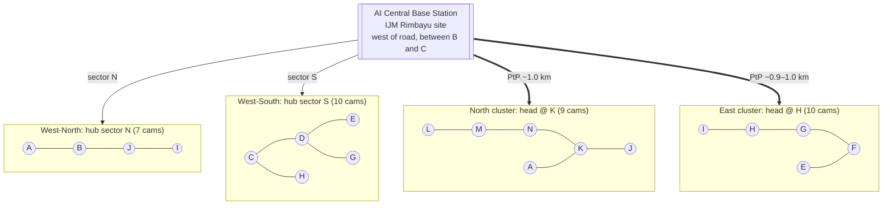
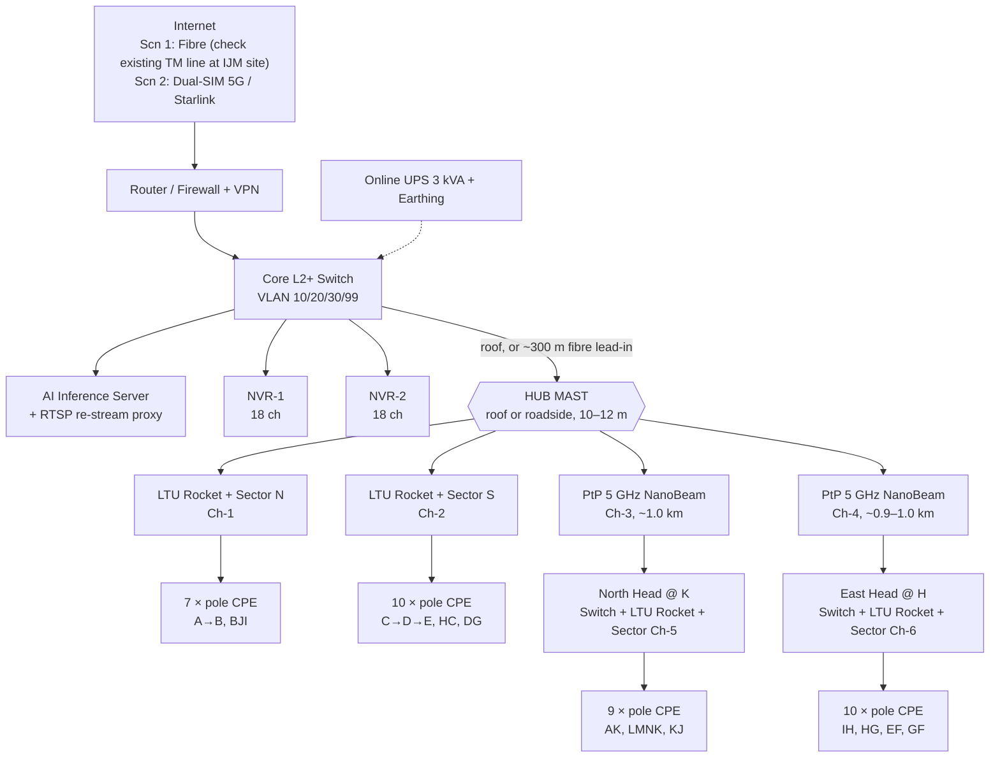
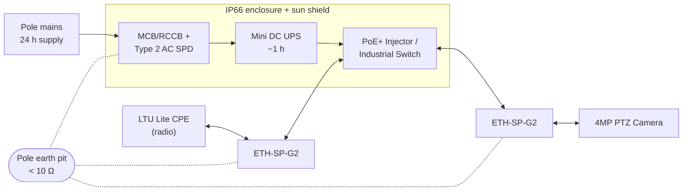
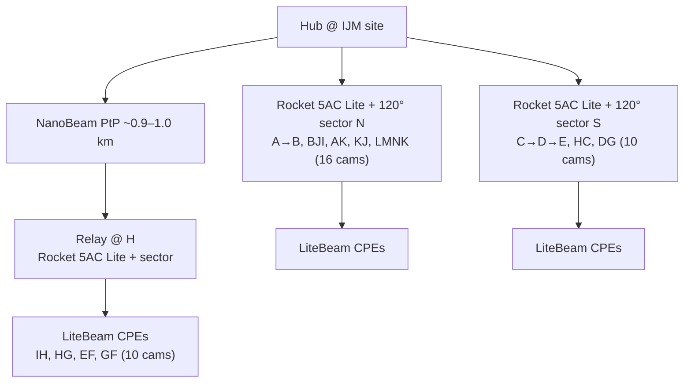
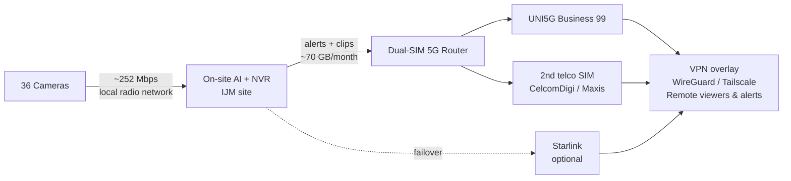

# Bandar Rimbayu Roadside PTZ CCTV – Network Architecture & 3-Tier BOM

**Project:** IJM Bandar Rimbayu road theft-detection CCTV
**Cameras:** 36 PTZ (design basis, pending confirmation)
**Version:** v2, 7 Oct 2026
**Status:** Planning estimate. All prices must be replaced with formal quotes.

> **v2 change: hub relocated.** The AI Central Base Station is now at the **IJM Rimbayu / IJM Land site**. That is the red box on the site map, on the **west side of the main road (ABCDE), between B and C**.
>
> Measured roughly from the map, the site is about **400 m from C** and about **800 m from D**, so it is closer to C than to D. Please confirm the exact building.
>
> Its roughly central position shortens the longest radio path to about 1.3 km. It also balances the clusters better: the busiest sector now carries **70 Mbps instead of 84 Mbps**.

---

## 1. Summary

- **Do not use WiFi + extenders.** Each single-radio repeater hop roughly halves usable throughput, and 36 continuous video uplinks would overload it.
- **Recommended: Plan 2.** Two-tier 5 GHz Ubiquiti LTU point-to-multipoint (PtMP), with **one CPE (pole radio) per camera pole**. The hub at the IJM site serves the main road directly. Two backhaul links feed cluster heads at **K (North)** and **H (East)**. Total **≈ RM231.6k** including cameras.
- **Premium: Plan 1.** Fibre on the poles with 60 GHz failover, **≈ RM326.0k**.
- **Budget: Plan 3.** Single-tier airMAX with bitrate caps, **≈ RM140.6k with 2MP cameras / RM165.7k with 4MP**.
- **No fibre at the base station is workable** if the AI and NVR run on site, using a dual-SIM 5G router plus an optional Starlink backup. The IJM site is an existing commercial building, so **first check whether TM/Unifi fibre is already there or can be extended**.

---

## 2. Fact-check notes

| Item | Issue | Resolution |
|---|---|---|
| "1080p (4MP)" | 1080p is **2MP**; 4MP is 2560×1440 | Design uses **4MP H.265**, with 2MP as the cheaper option |
| Camera count | Table rows sum to **36**, not the stated 32 (earlier 31) | Designed for **36**. Confirm |
| Hub "close to D" | From the map, the red box is closer to **C** (~400 m) than to D (~800 m) | Design uses the red-box location as marked |
| Hub line of sight | The IJM site sits ~250–300 m back from the road, behind trees and landscaping | Either a roof mast if the roof can see the road, **or** a short fibre lead-in to a radio mast at the roadside (budgeted) |
| WiFi + extenders | Throughput halves per hop, and clients contend for airtime | Replaced with TDMA PtMP radio or fibre |
| MCMC limit | 5.725–5.875 GHz is capped at **1 W EIRP** | Range comes from antenna gain and line of sight, not more power |

---

## 3. Bandwidth calculations

| Camera (main + sub stream) | H.264 | H.265 |
|---|---|---|
| 2MP | 6.5 Mbps | 4 Mbps |
| **4MP** | 11 Mbps | **7 Mbps** (planning basis) |

Total arriving at the hub for 36 cameras:

| Scenario | Total |
|---|---|
| 2MP H.265 | 144 Mbps |
| 2MP H.264 | 234 Mbps |
| **4MP H.265** | **252 Mbps** |
| 4MP H.264 | 396 Mbps |

**Pull each RTSP stream once only.** Re-stream it locally at the hub (MediaMTX, go2rtc, or the NVR's re-stream) to both the NVR and the AI server. If both pull from every camera, radio traffic doubles to ~504 Mbps.

### Per-cluster load, v2 (4MP H.265; H.264 in brackets)

| Cluster | Served by | Segments | Cams | Load |
|---|---|---|---|---|
| W-N (West-North) | Hub sector N | ABCDE north half (A→B→hub) 5 + BJI 2 | 7 | 49 (77) Mbps |
| W-S (West-South) | Hub sector S | ABCDE south half (hub→C→D→E) 5 + HC 2 + DG 3 | 10 | 70 (110) Mbps |
| North | Cluster head @ **K** via PtP | AK 1 + LMNK 4 + KJ 4 | 9 | 63 (99) Mbps |
| East | Cluster head @ **H** via PtP | IH 3 + HG 3 + EF 3 + GF 1 | 10 | 70 (110) Mbps |
| **Total** | | | **36** | **252 (396) Mbps** |

### Storage, 30-day retention
At a 4–6 Mbps recorded average, 36 cameras need **~47–70 TB**. Plan **64 TB raw** across 2 × 32-channel NVRs (18 cameras each).

---

## 4. Architecture

### 4.1 Site clusters (v2, hub at IJM site)

**Approximate distances from the hub** (estimated from the map; verify with Google Maps "Measure distance"):
- K: ~1.0 km
- M/L (furthest north): ~1.3 km
- H: ~0.9–1.0 km
- G: ~1.2 km
- E: ~1.3 km
- C: ~0.4 km

All are well within 5 GHz range at MCMC power limits.

**Hub mast options:**
1. **Roof mast** on the IJM building (10–12 m above ground), if it has clear line of sight to the road and to K and H.
2. **Roadside hub mast** on a pole beside the road near the hub. It connects to the server room by a **~300 m single-mode fibre lead-in**. Use this if trees or buildings block the roof.

Both options are budgeted; option 2 is the RM5k lead-in line.

### 4.2 Recommended topology – Plan 2 (v2)

### 4.3 Per-pole wiring (all plans, unchanged)

### 4.4 Plan 1 topology (v2): fibre rings + 60 GHz failover

```mermaid
flowchart LR
    HUB["Hub Core Switch<br/>IJM site"]
    HUB == "SM fibre ring" ==> R1["Ring West-North<br/>7 pole switches"]
    HUB == "SM fibre ring" ==> R2["Ring West-South<br/>10 pole switches"]
    HUB == "SM fibre ring" ==> R3["Ring North<br/>9 pole switches"]
    HUB == "SM fibre ring" ==> R4["Ring East<br/>10 pole switches"]
    HUB --- WAVE["Wave AP Micro 60 GHz<br/>aimed NE, 5 GHz backup"]
    WAVE -. failover .-> NK["Wave Nano @ K"]
    WAVE -. failover .-> NH["Wave Nano @ H"]
```

The West rings start right next to the hub, so a single fibre cut there is already covered by the ring itself. Wave failover is therefore only needed for the two **remote** clusters, K and H.

> ⚠️ Check that K (north) and H (east) both fall inside the Wave AP Micro's 90° beam from the hub mast. If they don't, add a second Wave AP Micro (+RM2,450).

### 4.5 Plan 3 topology (v2): single-tier airMAX

> ⚠️ In Plan 3, sector N carries 16 cameras: 16 × 4.5 Mbps ≈ **72 Mbps**, at distances up to ~1.3 km. The LMNK cameras may have no clear line of sight past the shophouses near K/N. If the survey fails, add a small relay at K (about +RM2,500).

### 4.6 Link engineering

- **Fresnel clearance at 5.8 GHz** (60% of the first zone at the midpoint):
  - 0.5 km link: 1.5 m
  - 1.0 km link: 2.2 m
  - 1.3 km link: 2.5 m
- **Link budget:** the longest path (~1.3 km) gives about –61 dBm received at 1 W EIRP with a 19 dBi antenna, which is comfortable.
- **Main risks:**
  - the trees and landscaping between the IJM building and the road
  - the shophouse blocks at the north end (K/N)
- **LTU settings:** GPS sync, 20–40 MHz channels, TDMA frame at **50/50** (the most uplink available).

---

## 5. Common items

### 5a. Cameras
| Qty | Item | Unit (RM) | Total (RM) |
|---|---|---|---|
| 36 | Hikvision DS-2DE4425IW-DE(T5) 4MP 25× PTZ, PoE+, max 18 W | 2,000 | 72,000 |
| 36 | Pole-mount adaptor | 80 | 2,880 |
| | **Subtotal, 4MP** | | **74,880** |
| *alt.* 36 | DS-2DE4225IW-DE(T5) 2MP 25× PTZ | 1,382 | 49,752 |

### 5b. Hub / AI base station at the IJM site (Plans 1 & 2)
| Qty | Item | Unit (RM) | Total (RM) |
|---|---|---|---|
| 1 | Core L2+ switch, 24×1G + 4×10G SFP+ | 2,800 | 2,800 |
| 2 | Hikvision DS-7732NI-K4 32-ch NVR | 1,550 | 3,100 |
| 8 | 8 TB surveillance HDD (WD Purple Pro) | 2,256 | 18,048 |
| 1 | Online UPS 3 kVA | 5,000 | 5,000 |
| 1 | 27U rack, PDU, patch panel, ODF | 2,500 | 2,500 |
| 1 | Router/firewall, dual-WAN, VPN | 800 | 800 |
| 1 | Hub mast, 6 m (roof or roadside) | 3,000 | 3,000 |
| 1 | Hub SPD + earth pit + bonding | 2,500 | 2,500 |
| | **Subtotal** | | **37,748** |

### 5c. Standard pole kit (per pole, Plans 1 & 2)
| Item | RM |
|---|---|
| IP66 enclosure + sun shield | 250 |
| MCB/RCCB + Type 2 AC SPD | 180 |
| 2 × ETH-SP-G2 | 130 |
| Earth rod/bonding kit | 150 |
| Mini DC UPS | 350 |
| STP Cat6, glands, conduit | 150 |
| **Per pole** | **1,210** |
| **× 36 poles** | **43,560** |

---

## 6. Plan 1 – Premium: fibre + 60 GHz failover (≈ RM326.0k)

| Qty | Item | Unit (RM) | Total (RM) |
|---|---|---|---|
| 5,700 m | 12-core SM ADSS fibre, aerial, installed (includes ~300 m hub lead-in) | 12/m | 68,400 |
| 40 | Splice closures + pigtails | 250 | 10,000 |
| 1 lot | Fusion splicing + OTDR test | 8,000 | 8,000 |
| 36 | TP-Link Omada IES210GPP industrial PoE switch | 899 | 32,364 |
| 36 | 48 V DIN-rail PSU, 120 W | 180 | 6,480 |
| 80 | 1G SM BiDi SFP | 60 | 4,800 |
| 1 | Ubiquiti Wave AP Micro | 2,450 | 2,450 |
| 2 | Ubiquiti Wave Nano (K, H) *(v1 had 4)* | 1,370 | 2,740 |
| 36 | Standard pole kit | 1,210 | 43,560 |
| 36 | Installation (skylift + crew) | 600 | 21,600 |
| 1 | Configuration/commissioning | 8,000 | 8,000 |
| 1 | Survey, drawings, permits | 5,000 | 5,000 |
| | **Network subtotal** | | **213,394** |
| | + Hub | | 37,748 |
| | + Cameras, 4MP | | 74,880 |
| | **TOTAL** | | **≈ 326,022** |

---

## 7. Plan 2 – Mid (Recommended): two-tier 5 GHz LTU (≈ RM231.6k)

| Qty | Item | Unit (RM) | Total (RM) |
|---|---|---|---|
| 4 | Ubiquiti LTU Rocket (2 at hub, 1 at K, 1 at H) | 1,950 | 7,800 |
| 4 | 5 GHz sector antenna, 90–120° | 800 | 3,200 |
| 4 | NanoBeam 5AC Gen2 (2 PtP pairs: hub→K, hub→H) *(v1: 3 pairs)* | 500 | 2,000 |
| 2 | TP-Link Omada IES210GPP at cluster heads K and H *(v1: 3)* | 899 | 1,798 |
| 36 | Ubiquiti LTU Lite CPE | 499 | 17,964 |
| 36 | Industrial PoE+ injector, 30 W | 150 | 5,400 |
| 2 | Cluster-head extension arm *(v1: 4)* | 500 | 1,000 |
| 36 | Standard pole kit | 1,210 | 43,560 |
| 36 | Installation per pole | 450 | 16,200 |
| 1 | RF survey, alignment, commissioning | 10,000 | 10,000 |
| 1 | Survey, drawings, permits | 5,000 | 5,000 |
| 1 | **New:** hub fibre lead-in, ~300 m SM + SFPs + roadside mast cabinet (only if the roof lacks line of sight) | 5,000 | 5,000 |
| | **Network subtotal** | | **118,922** |
| | + Hub | | 37,748 |
| | + Cameras, 4MP | | 74,880 |
| | **TOTAL** | | **≈ 231,550** |

- **Pros:**
  - The central hub means 17 of the 36 cameras connect in a single radio hop.
  - The busiest sector carries 70 Mbps (v1: 84 Mbps).
  - Only two remote cluster heads are needed.
- **Cons/risks:**
  - Line of sight from the IJM site to the road, K and H must be proven by survey.
  - It depends on Ubiquiti as a single vendor.
  - Trees will keep growing into the links.

---

## 8. Plan 3 – Budget: single-tier airMAX (≈ RM140.6k with 2MP / RM165.7k with 4MP)

Cap the H.265 main stream at **4 Mbps**, or use 2MP cameras.

| Qty | Item | Unit (RM) | Total (RM) |
|---|---|---|---|
| 3 | Rocket 5AC Lite (2 at hub, 1 relay at H) | 660 | 1,980 |
| 3 | AM-5G19-120 sector | 750 | 2,250 |
| 2 | NanoBeam 5AC Gen2 (PtP hub→H) | 500 | 1,000 |
| 36 | LiteBeam 5AC Gen2 CPE | 359 | 12,924 |
| 36 | PoE+ injector, 30 W | 120 | 4,320 |
| 36 | Reduced pole kit (no UPS) | 580 | 20,880 |
| 36 | Installation per pole | 350 | 12,600 |
| 1 | Commissioning | 5,000 | 5,000 |
| 1 | Permits/drawings | 5,000 | 5,000 |
| 1 | **New:** hub fibre lead-in / roadside mast (if needed) | 5,000 | 5,000 |
| | **Network subtotal** | | **70,954** |
| | Reduced hub | | 19,896 |
| | + Cameras, 2MP / 4MP | | 49,752 / 74,880 |
| | **TOTAL** | | **≈ 140,602 / 165,730** |

---

## 9. Plan comparison (v2)

| | Plan 1 Premium | Plan 2 Mid ⭐ | Plan 3 Budget |
|---|---|---|---|
| Backbone | Fibre rings + 60 GHz failover | 5 GHz LTU, 2 tiers | 5 GHz airMAX, 1 tier |
| Total (RM) | ~326.0k | ~231.6k | ~140.6k–165.7k |
| Busiest sector load | n/a (fibre) | 70 Mbps | 72 Mbps (capped) |
| Remote cluster heads | 2 (K, H) | 2 (K, H) | 1 (H) |
| Weather/RF risk | Very low | Medium | Medium–High |
| Permit difficulty | High | Medium | Medium |

---

## 10. Scenario 2 – No fibre at the base station

| Option | Upfront | Monthly (RM) | Notes |
|---|---|---|---|
| Existing/extended fibre at IJM site (Unifi Business 100 Mbps) | Router included | ~129 | **Check first.** The site is an established commercial building |
| Unifi Air Biz 5G | Free router (24-month contract) | 99–149 | Throttled after 1 TB/month |
| UNI5G Business 99 in your own dual-SIM router | Router ~1,000–2,000 | 99 | Recommended primary if there is no fibre |
| 2nd telco SIM | – | ~60–120 | Network diversity |
| Starlink Standard | Kit 1,600 | 135–235 | Independent failover; verify current plans |

- **Never stream all 36 cameras off-site.** That needs ~252 Mbps continuous.
- Use a **VPN overlay** for remote access, and never port-forward the NVR.
- Run speed tests at the **hub mast location** to choose the SIMs.

---

## 11. Regulatory & environment

- **MCMC:**
  - 5470–5650 and 5725–5875 MHz: **1 W EIRP**
  - 5150–5350 MHz: indoor only
  - 57–64 GHz: 10 W EIRP
  - Use only certified units
- **Permissions:**
  - **MPKL** for handed-over roads and poles
  - **IJM Land consent** for roads not yet handed over, **and now also for hosting the server room and roof mast at the IJM site**
  - Agree on rack space, air-conditioning, a dedicated power circuit and 24/7 access
- **60 GHz rain fade:** about 28 dB/km at 100 mm/h. The Plan 1 failover links (~1 km) will drop to their 5 GHz backup during storms.
- **Lightning:** put an AC SPD, ETH-SP-G2 surge protectors, STP cable and earth bonding below 10 Ω on **every pole and the hub mast**.
- **Heat:** use industrial-temperature switches and injectors in the pole enclosures.

---

## 12. Assumptions

1. **Power is available at every pole 24 hours a day, day and night.** It is not photocell-switched street lighting only.
2. **36 cameras** is the design basis (sum of table rows). To be confirmed.
3. **The AI Central Base Station is at the IJM Rimbayu / IJM Land site** (red box), west of the main road between B and C. Cluster heads are at **K** and **H**.
4. Distances are estimated from satellite imagery (±15%). Verify them in the site survey.
5. Cameras are 4MP H.265 at a 7 Mbps planning rate, with one RTSP pull per camera.
6. **All prices are estimates (Oct 2026).** USD prices are converted at ~RM4.25 plus ~15% margin, and SST is excluded. Replace with distributor quotes (TSDM, Synchroweb, uWave).
7. Poles are 8–12 m tall and can carry ~10–15 kg of extra load.
8. IJM Land allows the server rack and mast at its site.

---

## 13. Deployment precautions

1. **Line-of-sight survey from the IJM site first.** Check the roof against the roadside mast option, the path to K (past the shophouses) and the path to H.
2. **Bench staging** at the hub: configure all devices first, then run a 48-hour burn-in.
3. **IP plan / VLANs:**
   - VLAN 10 management: `10.10.0.0/16`
   - VLAN 20 cameras: `10.20.<cluster>.<pole>`, with clusters 1 = W-N, 2 = W-S, 3 = North, 4 = East
   - VLAN 30 NVR/AI: `10.30.0.0/24`
   - VLAN 99 WAN
4. **Labelling.** Use pole IDs such as `RB-WS-CDE-03` on enclosures, cables, radio names and the camera OSD (on-screen text). Keep an as-built sheet with GPS, MAC, IP, azimuth and tilt.
5. **Protection QA.** Test earth resistance and photograph the surge protector bonding at every pole and at the hub.
6. **Commissioning.** Run a 72-hour full-bitrate soak with PTZ tours, and capture at least one rainstorm.
7. **Operations.** Every 6 months, check link health and prune trees. Set UISP/Omada to alert if a CPE signal drops by more than 6 dB.
